<picture>
  <source media="(prefers-color-scheme: dark)" srcset="https://raw.githubusercontent.com/Ringmast4r/Ringmast4r/output/github-contribution-grid-snake-dark.svg" />
  <source media="(prefers-color-scheme: light)" srcset="https://raw.githubusercontent.com/Ringmast4r/Ringmast4r/output/github-contribution-grid-snake.svg" />
  
</picture>

<div align="center">

# NotClaw

[](https://ollama.ai)
[](https://github.com/ultraworkers/claw-code)
[](ARTOFWAR-RUNNING-INVENTORY.md)
[](#workspace-status)
[](#how-an-llm-actually-answers-you)

[](https://git.io/typing-svg)

**Not Claude Code. Not in the cloud. Not paying per token.**
**Our rig. Our research. Our traps — written down so we don't hit them twice.**

</div>

---

## Table of contents

<details>
<summary><b>Click to expand</b></summary>

1. [What this is](#what-this-is)
2. [Why NotClaw exists](#why-notclaw-exists)
3. [Timeline — from leak to workspace](#timeline--from-leak-to-workspace)
4. [Files in this folder](#files-in-this-folder)
5. [The stack at a glance](#the-stack-at-a-glance)
6. [Request lifecycle — what happens when you hit Enter](#request-lifecycle--what-happens-when-you-hit-enter)
7. [How an LLM actually answers you](#how-an-llm-actually-answers-you)
8. [The VRAM budget (and why it's tighter than you think)](#the-vram-budget-and-why-its-tighter-than-you-think)
9. [KV cache — the hidden VRAM tax](#kv-cache--the-hidden-vram-tax)
10. [Picking the right model — a flowchart](#picking-the-right-model--a-flowchart)
11. [Model selection quadrant](#model-selection-quadrant)
12. [Speed & quality leaderboard](#speed--quality-leaderboard)
13. [Hardware we've tested on](#hardware-weve-tested-on)
14. [The 2026-04-17 black-screen — visualized](#the-2026-04-17-black-screen--visualized)
15. [**Growing pains log (2026-04-17)** — the artofwar CPU-offload cascade, version skew, openclaw, and how we clawed back 100x latency](#growing-pains-log-2026-04-17)
16. [Ollama env vars cheat sheet](#ollama-env-vars-cheat-sheet)
16. [Model tier summary](#model-tier-summary)
17. [Primer: What is quantization?](#primer-what-is-quantization)
18. [Primer: What is "thinking mode"?](#primer-what-is-thinking-mode)
19. [Primer: Why tool-use support matters](#primer-why-tool-use-support-matters)
20. [Seven traps we've hit (and won't again)](#seven-traps-weve-hit-and-wont-again)
21. [Pre-launch checklist (flowchart)](#pre-launch-checklist-flowchart)
22. [Troubleshooting flowchart](#troubleshooting-flowchart)
23. [Model lifecycle (state machine)](#model-lifecycle-state-machine)
24. [Cost: local vs real Claude](#cost-local-vs-real-claude)
25. [NotClaw mindmap — the whole space](#notclaw-mindmap--the-whole-space)
26. [Related — but separate](#related--but-separate)
27. [Workspace status](#workspace-status)
28. [Glossary](#glossary)
29. [FAQ](#faq)
30. [Credits](#credits)

</details>

---

## What this is

A private, NTFS-locked workspace holding **our** documentation and research for running Claude-Code-style coding agents **100% locally** on our own hardware. It doubles as an educational text on how local LLM agents actually work — every diagram in this document is here because at some point we needed it to debug something real.

> **NotClaw = not Claude-the-cloud-product. Same shape, yours.**
> Runs offline. No Anthropic API key. No billing. No "wait, did my code just get sent somewhere?"

It is **not** a GitHub fork of claw-code or claude-code. It is a sibling project on top of them, focused on sanity, safety, and sizing for real consumer hardware — plus enough LLM primer to understand *why* the advice is what it is.

---

## Why NotClaw exists

Three things collided in March–April 2026:

1. The [**Claude Code source-map leak**](https://github.com/ultraworkers/claw-code) (March 31, 2026) exposed the agent harness's internals. Within days, Rust and Python ports appeared at 185k stars each.
2. **Ollama** made running 32B-parameter models on consumer GPUs a one-command affair.
3. **`qwen2.5-coder`** shipped with native tool-use and no thinking-mode overhead — the first truly agent-ready open model.

The combination meant you could run a Claude-Code-style agent on your own PC. The community rushed in, and the ecosystem filled up with `claw-code`, `claude-code`, `clawd-code`, `clawd-codex`, `claurst`, and a dozen other fork variants. Most of them ship configs that were tuned on somebody's multi-GPU rig and silently black-screen consumer PCs.

NotClaw exists to document **what actually works on what hardware**, with the math to back it up.

---

## Timeline — from leak to workspace

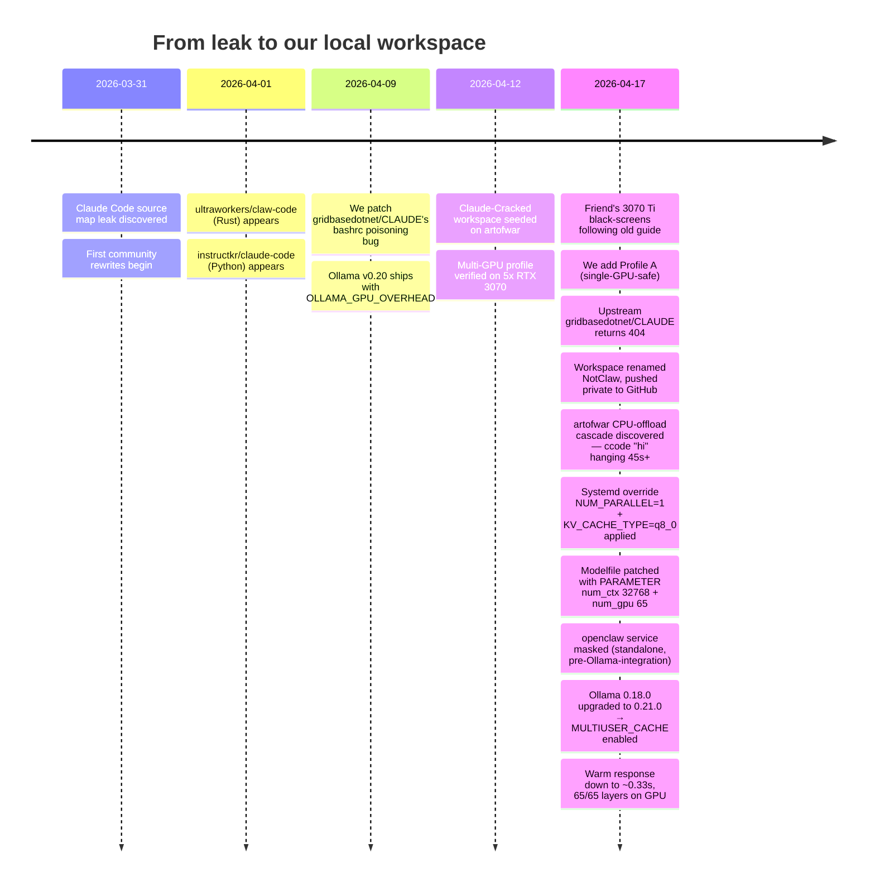

---

## Files in this folder

| File | Purpose |
|---|---|
| **[`README.md`](README.md)** | This file — landing page + educational primer + reference cards. |
| **[`LOCAL-CLAUDE-SETUP.md`](LOCAL-CLAUDE-SETUP.md)** | Deep step-by-step walkthrough: VRAM-tier table, Profile A/B systemd configs, Step 7 smoke test, 7 gotchas, the 2026-04-17 crash case study, emergency recovery. **Start here if setting up a rig.** |
| **[`ARTOFWAR-RUNNING-INVENTORY.md`](ARTOFWAR-RUNNING-INVENTORY.md)** | Living inventory of `artofwar` (10.0.0.30) — running services, paste-in triage block for when inference gets slow. |
| `.gitignore` | Standard Windows / editor / secret-adjacent patterns excluded. |

---

## The stack at a glance


**Every arrow is an HTTP or in-process call you control.** Nothing leaves the box. You can unplug your ethernet cable and this entire pipeline still works.

---

## Request lifecycle — what happens when you hit Enter

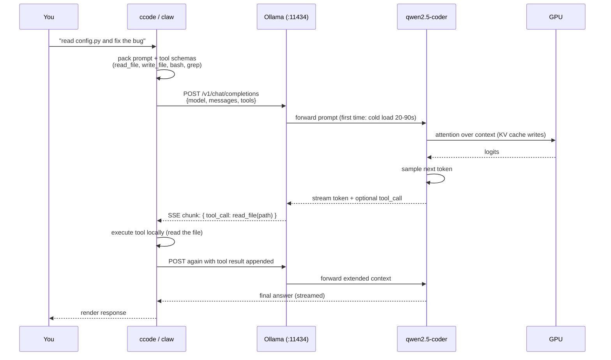

**Where latency comes from:**
- **Cold load** (first prompt after idle): 20–90 seconds to copy model weights from SSD into VRAM. Only happens once.
- **Prefill** (processing your prompt): scales with prompt length × model size. Usually < 1s on a 7b, 2–5s on a 32b.
- **Generation** (producing tokens one at a time): the token/s number everyone quotes. ~15 tok/s on a 32b, ~35 tok/s on a 7b.
- **Tool loops** (every tool call is a round trip): on a multi-step task, this dominates. A 4-tool task at 15 tok/s means 4 prefills + 4 generations, even if each individual response is short.

---

## How an LLM actually answers you

A 60-second primer so the rest of this document makes sense.

### Step 1: Tokenization

Your prompt becomes a sequence of integer **tokens**. The tokenizer's vocabulary (for qwen2.5-coder: ~150k tokens) was learned during pretraining. Common words, symbols, and code idioms become single tokens; rare strings split into pieces.

### Step 2: Attention — the transformer forward pass

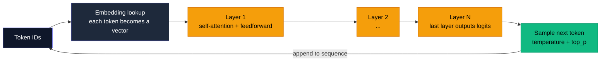

Every layer's self-attention looks at **every previous token** to decide what to emit next. That's where the **KV cache** comes from — each token's key/value vectors are cached so the next token doesn't have to recompute attention from scratch. This is also why longer contexts use more VRAM (see next section).

### Step 3: Token streaming

Models don't return the whole reply at once. They emit one token, append it to the context, run the forward pass again, emit the next token, and so on. You see streaming output because the server sends each token over HTTP as soon as it's sampled.

### Step 4: Tool calls

When the model "wants" to call a tool, it emits a structured JSON token sequence instead of prose. The harness (claw) parses that, executes the tool locally (reads a file, runs bash), and appends the result to the conversation. Then the model continues, often chaining multiple tools.

**None of this requires Anthropic.** Every step runs on your box.

---

## The VRAM budget (and why it's tighter than you think)

A model's "size" (7b, 14b, 32b) is only one component of its VRAM footprint. Here's what actually lives on the card:

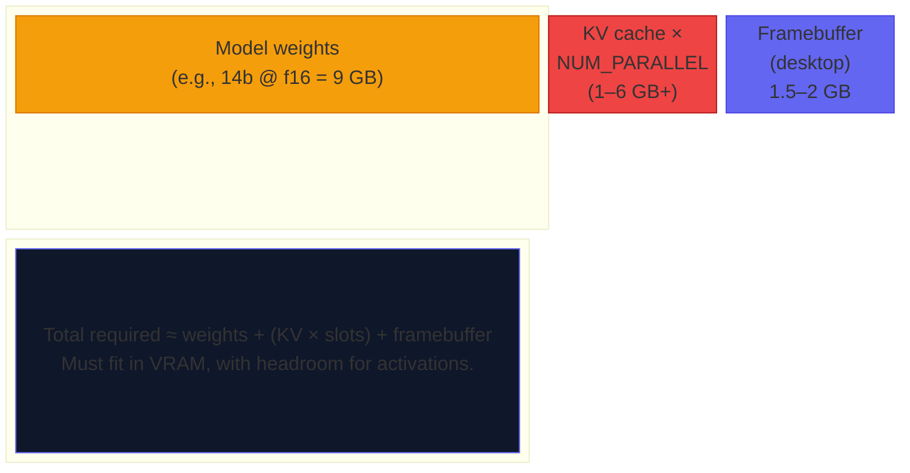

**Rules of thumb:**
- **Weights:** pretty much what `ollama pull` says on the tin (14b ≈ 9 GB at f16, 4.5 GB at q4).
- **KV cache per slot:** ~1–2 GB for mid-size models at 32k context, ~300–500 MB for smaller ones. Scales linearly with context length and `NUM_PARALLEL`.
- **Framebuffer:** only matters if your GPU drives a display. 1.5–2 GB is typical for a busy desktop + browser.
- **Activations / scratch:** another ~5–10% of the model size during forward pass.

Forget any of these and you crash. This is exactly what happened on 2026-04-17 — see [the sankey below](#the-2026-04-17-black-screen--visualized).

---

## KV cache — the hidden VRAM tax

The KV cache is the biggest surprise in local LLM VRAM budgeting. It grows with **context length** (how much of the conversation is in memory) and with **concurrent slots** (`OLLAMA_NUM_PARALLEL`). Visualized:

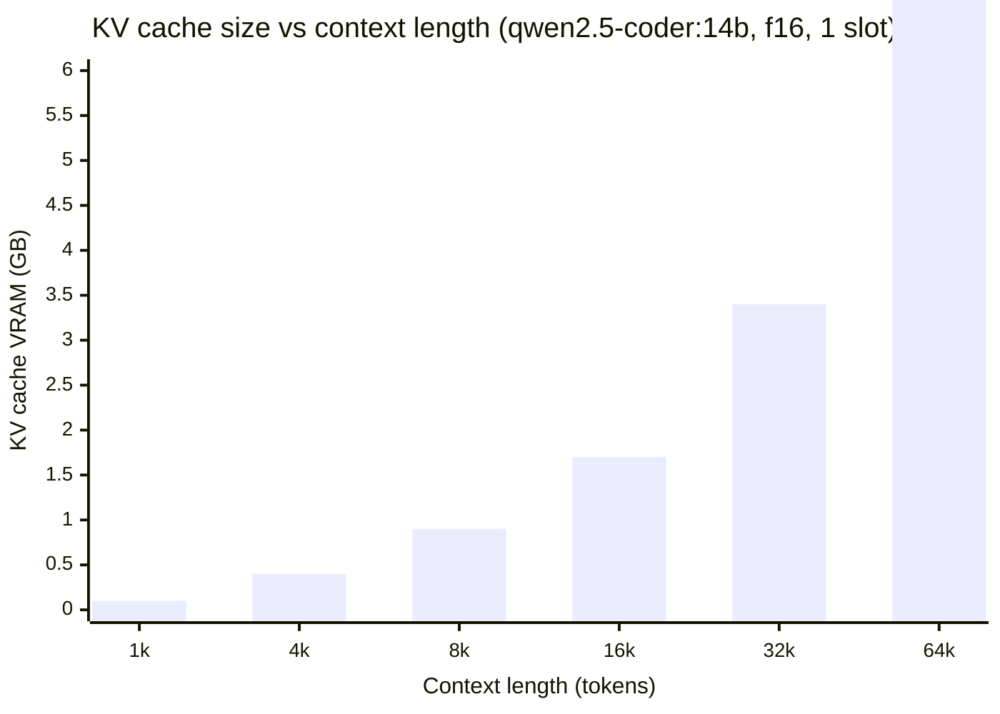

If you bump `NUM_PARALLEL` from `1` to `4`, multiply those numbers by 4. On a 12 GB card running the 14b at 32k context with `NUM_PARALLEL=4`:

```
Weights     :  9.0 GB
KV × 4      : 13.6 GB     ← already over budget
Framebuffer :  1.5 GB
            : ───────
Total       : 24.1 GB  on a 12 GB card.
```

**Mitigations (ordered by impact):**
1. Set `OLLAMA_NUM_PARALLEL=1` on single-GPU rigs.
2. Set `OLLAMA_KV_CACHE_TYPE=q8_0` to quantize the KV cache (cuts it 2–4x).
3. Reduce `num_ctx` in the model's Modelfile or per-request options.
4. Pick a smaller model tier.

---

## Picking the right model — a flowchart

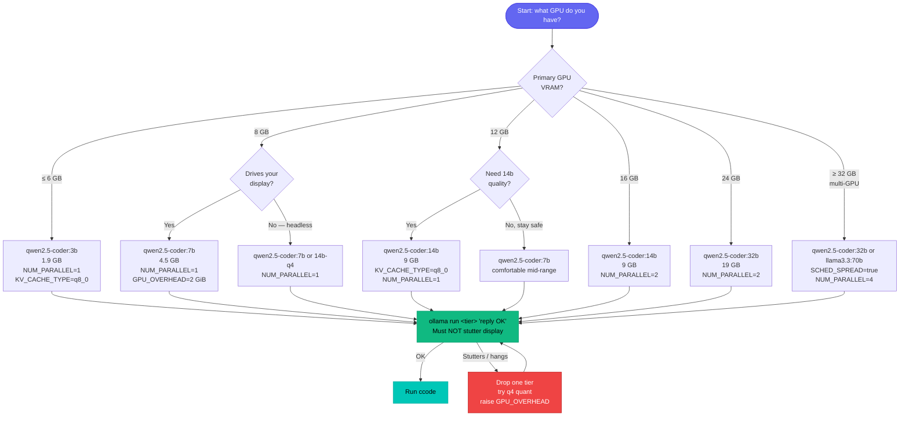

---

## Model selection quadrant

Where the common Ollama-compatible models land on the two axes that actually matter: **how much VRAM they need** and **whether they're usable as agents (tool-capable)**.

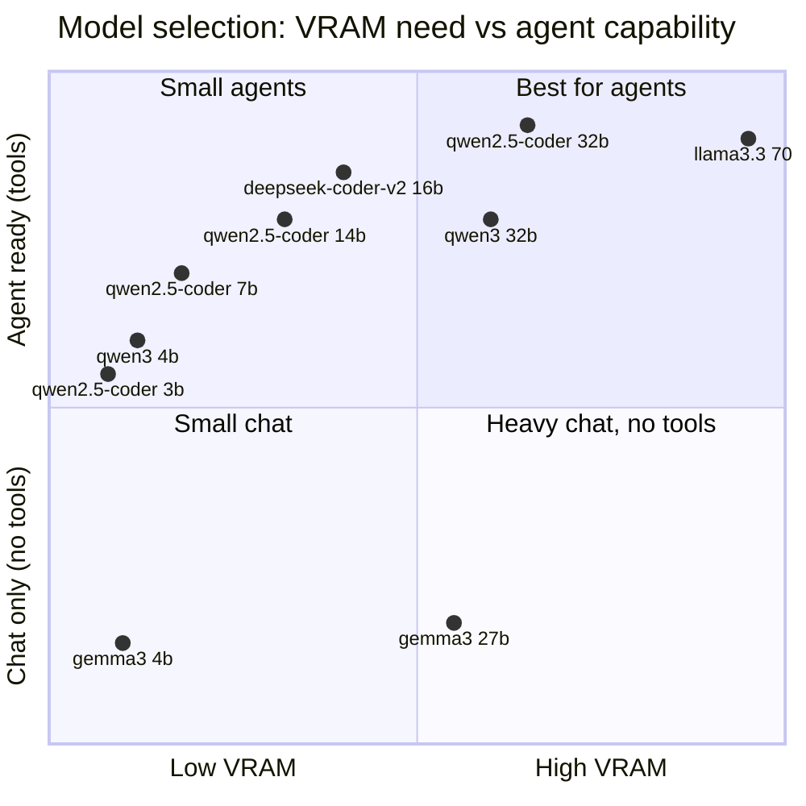

- **Top-right** is where you want to be for agent work — `qwen2.5-coder:32b` is the sweet spot on multi-GPU rigs; `qwen2.5-coder:14b` on a single 16 GB card.
- **Bottom** = chat-only. Gemma 3 doesn't expose tool-use in Ollama regardless of size.
- **Left = sub-6 GB cards**. The `3b` and `gemma3:4b` tiers keep laptops and integrated graphics in the game.

---

## Speed & quality leaderboard

Real measurements from our `artofwar` 5×RTX 3070 rig (40 GB VRAM total):

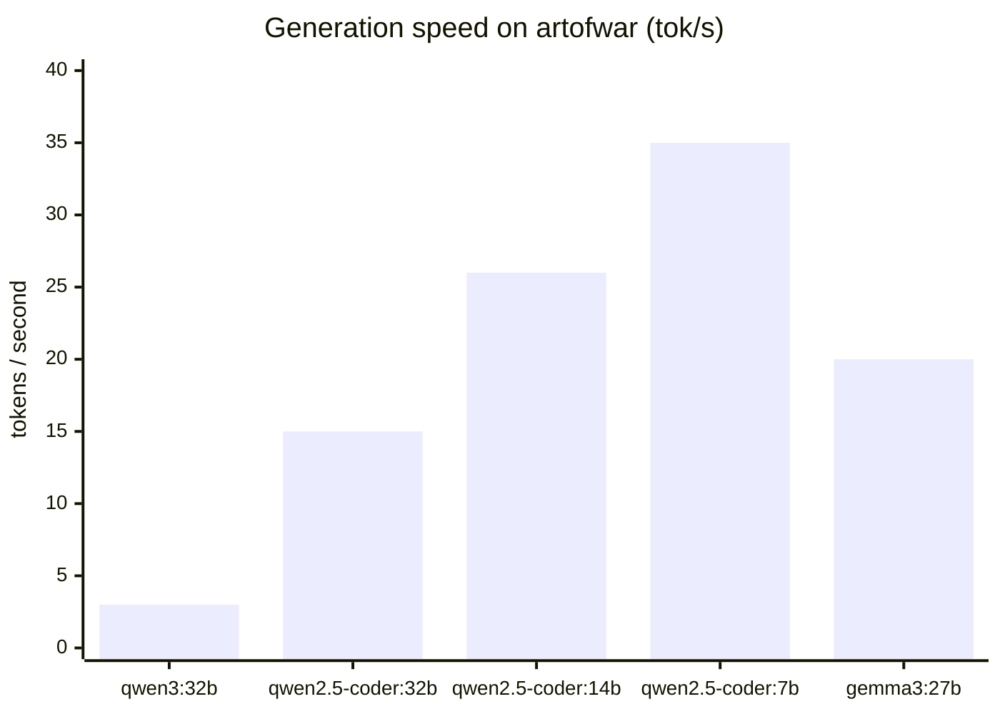

- `qwen3:32b` is slow because of thinking mode (see [primer](#primer-what-is-thinking-mode)).
- `gemma3:27b` is fast but **unusable as an agent** — no tool support in Ollama.
- `qwen2.5-coder:32b` is the best speed/quality/tool-capability combo on our rig.
- `qwen2.5-coder:7b` is the safety tier for 8 GB single-GPU rigs.

---

## Hardware we've tested on

### `artofwar` — our main rig (headless, dedicated)

```
GPU Layout (during 32b inference, OLLAMA_SCHED_SPREAD=true):

GPU 0: 7,609 / 8,192 MiB  [███████████████████▓░]  93%
GPU 1: 6,943 / 8,192 MiB  [█████████████████▓░░░]  85%
GPU 2: 6,975 / 8,192 MiB  [█████████████████▓░░░]  85%
GPU 3: 6,975 / 8,192 MiB  [█████████████████▓░░░]  85%
GPU 4: 7,137 / 8,192 MiB  [█████████████████▓░░░]  87%
───────────────────────────────────────────────────────
Total: 35.6 / 40.0 GB                                89%
```

- 5× NVIDIA RTX 3070, 40 GB VRAM total, no display attached.
- **Profile B** systemd config (see LOCAL-CLAUDE-SETUP.md), plus overrides applied 2026-04-17 after the CPU-offload incident (see [Growing Pains Log](#growing-pains-log-2026-04-17)).
- Runs `qwen2.5-coder:32b` — **65/65 layers on GPU**, 30 GB VRAM across 5 cards, cold load ~100s, **warm response ~0.33s for small prompts**, ~14 tok/s generation.
- `OLLAMA_MULTIUSER_CACHE=true` (since upgrade to Ollama 0.21.0) — prompt-prefix caching drastically cuts claw's tool-schema re-eval cost.

### Buddy's PC — single RTX 3070 Ti (8 GB, display-driving)

The case study for most of our safety advice. Black-screened on 2026-04-17 following an older guide. See [visualization below](#the-2026-04-17-black-screen--visualized).

---

## The 2026-04-17 black-screen — visualized

The actual VRAM flow that killed the 3070 Ti. Arrows are sized to represent GB of VRAM demanded:

```mermaid
sankey-beta

%% source,target,value
Weights qwen2.5-coder:14b,VRAM demand,9
KV cache × NUM_PARALLEL=4,VRAM demand,6
Desktop compositor,VRAM demand,2
VRAM demand,Available 3070 Ti VRAM,8
VRAM demand,Overflow → CPU / unified memory,9
Overflow → CPU / unified memory,Driver hang → black screen,9
```

**Post-mortem math:**

| Item | GB |
|---|---:|
| Weights (14b, f16) | 9.0 |
| KV cache × 4 (`NUM_PARALLEL=4`) | ~6.0 |
| Desktop / compositor | ~1.5–2.0 |
| **Total demanded** | **~17** |
| **Available on 3070 Ti** | **8** |
| **Over budget** | **~9 GB** |

**What fixed it:** Profile A config — `qwen2.5-coder:7b`, `NUM_PARALLEL=1`, `OLLAMA_GPU_OVERHEAD=2147483648`, `OLLAMA_MAX_LOADED_MODELS=1`, pre-launch `ollama run` smoke test.

Full post-mortem in [LOCAL-CLAUDE-SETUP.md](LOCAL-CLAUDE-SETUP.md#case-study-the-3070-ti-black-screen-2026-04-17).

---

## Growing pains log (2026-04-17)

A full day of compounding weirdness on the artofwar rig. Each of these is a scar that's now a lesson, and together they produced the current working config. Timeline is chronological. If you hit similar symptoms on a multi-GPU box, work through this in order.

### Incident 1 — `ccode "hi"` hangs 45+ seconds

**Symptom:** user types `hi` in claw, no visible response, terminal appears frozen. Ctrl+C does nothing.

**First hypothesis (wrong):** cold model load across 5 GPUs — normal latency.

**Real cause:** the 32b model was running 100% on CPU. Zero layers on any GPU. Inference at ~0.5 tok/s.

**How we found it:**
- `nvidia-smi` — all GPUs at 0% utilization, 1.4 GB on GPU 0, 203 MB each on others (just CUDA runtime, nothing else).
- `curl /api/ps` — reported `size_vram: 68 GB` which is *more than total available VRAM* (5 × 8 = 40 GB). Red flag: Ollama was reporting the model as "in VRAM" while `nvidia-smi` said it wasn't.
- `ps` — one Ollama process holding **53 GB of system RAM** (81.8% of total RAM).
- Cross-referencing the two: the "in VRAM" number included CPU-offloaded weights because Ollama classifies anything the model backend touches as "VRAM" regardless of physical location. Classic instrumentation lie.

**Root cause in the ollama logs:**
```
load_tensors: offloading 0 repeating layers to GPU
load_tensors: offloaded 0/65 layers to GPU
load_tensors:    CUDA_Host model buffer size = 18508.35 MiB   ← CPU-pinned host memory
compute graph device=CUDA0 size="12.8 GiB"  (per GPU)
total memory size="113.9 GiB"
```

The server was requesting **12.8 GB of compute-graph-plus-KV per GPU** (each card has 8 GB). Over budget → fall back to CPU for everything. The demand came from `OLLAMA_NUM_PARALLEL=4` × `num_ctx` defaulting to 131072 (128k). Four parallel KV-cache slots at 128k each on a 32b model blew the per-GPU ceiling.

### Lesson 1 — Ollama's allocator is conservative, not optimistic

Ollama **does not** try to fit as much model as possible onto GPU and fall back layer-by-layer. It **estimates** total memory demand *before* loading. If the estimate exceeds any single GPU's available VRAM, it refuses to spread and dumps everything to CPU instead.

Mental model shift: **"plan and reject"** instead of **"try and fallback"**. The tuning knobs that matter are the ones that shrink the *pre-load estimate*:

- `OLLAMA_NUM_PARALLEL` (linearly scales KV demand)
- `OLLAMA_KV_CACHE_TYPE` (`q8_0` halves KV size)
- `num_ctx` (Modelfile `PARAMETER` — linearly scales KV)
- `num_gpu` (Modelfile `PARAMETER` — force full offload when allocator is wrong)

### Incident 2 — `OLLAMA_CONTEXT_LENGTH` silently ignored

**Symptom:** set `Environment="OLLAMA_CONTEXT_LENGTH=32768"` in systemd override, restarted, confirmed env was live in the service. But every cold load still tried to allocate for 131k context.

**Root cause:** artofwar was running **Ollama 0.18.0**. `OLLAMA_CONTEXT_LENGTH` was added in **Ollama 0.20+**. On 0.18 the env var exists as a string in the process environment but nothing reads it. No error, no warning — it's just a no-op.

### Lesson 2 — env-var-ignored-silently is a dangerous failure mode

When you add a new config knob and "nothing happens," don't assume the knob is being honored. Check the actual effective config via whatever diagnostic the daemon exposes (for Ollama: `journalctl` shows `server config env=...` at startup). If the var name appears with a default value instead of your set value, the binary doesn't know about it. This happens during version skew — which we also hit.

### Workaround — Modelfile `PARAMETER num_ctx`

Because 0.18 couldn't hear the env var, we baked the context cap into the model itself:

```bash
sudo -u ollama bash -c '
  ollama show --modelfile qwen2.5-coder:32b > /tmp/Modelfile
  echo "PARAMETER num_ctx 32768" >> /tmp/Modelfile
  ollama create qwen2.5-coder:32b -f /tmp/Modelfile
'
```

Two gotchas: **(1)** must run as the `ollama` user — the service user owns `/usr/share/ollama/.ollama/models/blobs/` and regular users get "permission denied" reading those files; **(2)** this overwrites the `qwen2.5-coder:32b` tag with a new digest, so any downstream tooling pinning the old digest will need updating.

### Incident 3 — 52/65 layers on GPU after the first fix

After applying `NUM_PARALLEL=1` + `num_ctx=32768`, Ollama offloaded 52 of 65 layers to GPU — a huge improvement over 0/65, but 13 layers still ran on CPU. This bottlenecked generation at ~6 tok/s instead of the rig's theoretical ~15 tok/s.

**Why:** Ollama's allocator still wanted headroom for activations + compute buffers and refused to use the last ~3 GB per card. Its conservatism costs performance even when the model would physically fit.

### Workaround — Modelfile `PARAMETER num_gpu <total_layers>`

Force all layers onto GPU regardless of allocator estimate:

```bash
echo "PARAMETER num_gpu 65" >> /tmp/Modelfile
ollama create qwen2.5-coder:32b -f /tmp/Modelfile
```

After applying: **65/65 layers on GPU**, ~14 tok/s. Used with care — if the estimate was right and the allocator's conservatism was warranted, you'll OOM mid-inference and the CUDA context dies.

### Incident 4 — "openclaw" on the box turned out to be two different things

While diagnosing, `pgrep -af openclaw` showed `openclaw` + `openclaw-gateway` processes listening on 127.0.0.1:24190–24193. User confirmed they'd set up "openclaw" for something but didn't remember what.

**Plot twist from the upstream research:**

Ollama v0.20.3+ release notes mention `OpenClaw` — it's an **integrated messaging-channel gateway** (WhatsApp, Telegram, Discord → Ollama) invoked via `ollama launch openclaw`. The artofwar box had a **standalone, older OpenClaw install** (systemd units at `/etc/systemd/system/openclaw.service` and `openclaw-watchdog.timer`) that predated the integration. Same name, completely different codebase.

### Lesson 3 — watch for name collisions in fast-moving ecosystems

When a feature gets absorbed upstream under an existing third-party name, you can end up with both running on the same box — the old standalone AND the new integrated version. `systemctl mask` handled it; the mask survives reboots. But watch for this pattern: a process name you don't remember setting up might be a legacy install that upstream is now shipping as a built-in.

### Incident 5 — the Ollama version-skew double-whammy

After applying `Environment="OLLAMA_MULTIUSER_CACHE=true"` to the override for the first time, the env appeared set — but the Ollama log showed `OLLAMA_MULTIUSER_CACHE:false` in the server config.

**Cause:** `OLLAMA_MULTIUSER_CACHE` was also added in v0.20+, same as `OLLAMA_CONTEXT_LENGTH`. On 0.18, it's another silent no-op.

**The fix (forced): upgrade Ollama.**

```bash
curl -fsSL https://ollama.com/install.sh -o /tmp/ollama-install.sh
sudo bash /tmp/ollama-install.sh
```

The official install script handles URL detection, tarball format (current release ships `ollama-linux-amd64.tar.zst`, not the `.tgz` we initially guessed), and in-place binary replacement. Systemd unit + our override are preserved. Modelfile PARAMETERs survive (stored in the model registry, not the binary).

### Lesson 4 — measure the effective config, not the requested config

After upgrade: `journalctl -u ollama | grep MULTIUSER` now shows `OLLAMA_MULTIUSER_CACHE:true`. The env var's value *and* the daemon's knowledge of it are two different things. Grepping the server-config log line at startup is the only reliable way to know what's actually active.

### Incident 6 — raw-mode TTY breaks Ctrl+C in claw

**Symptom:** typing `Ctrl+C` inside a `claw` / `ccode` session during a hung prompt does nothing. The character just prints as `^C` to the terminal and claw keeps waiting.

**Cause:** claw puts the TTY in **raw mode** to capture every keystroke for its input handler. In raw mode, Ctrl+C is delivered as the literal byte `0x03` to claw's stdin, *not* as a SIGINT to the process. If claw's input loop is synchronously blocked on an Ollama HTTP call, that byte sits in the buffer until claw gets around to reading it — which might be after inference finishes, 90 seconds later.

### Workaround — kill from outside the TTY

```
Ctrl+Alt+F2     (switch to a clean virtual terminal — or open a new SSH session)
pkill -INT claw; sleep 2
pkill -TERM claw; sleep 1
pkill -KILL claw
Ctrl+Alt+F1     (return to the original terminal)
reset           (restore cooked-mode TTY — corrupted shell back to sane)
```

Newer agent harnesses (aider, Claude Code itself) run inference on a background task and poll stdin on the main thread precisely to avoid this. claw's simpler threading model is the tradeoff.

### Net result — measured before and after

| Metric | Before (0.18, bad defaults) | After (0.21 + override + Modelfile + upgrade) |
|---|---|---|
| Layers on GPU | **0 / 65** | **65 / 65** |
| Weights in VRAM | ~2.2 GB (CUDA runtime only) | ~19 GB spread across 5 cards |
| Generation speed | ~0.5 tok/s (pure CPU) | ~14 tok/s (full GPU) |
| Warm response (small prompt) | 45+ seconds | **~0.33 seconds** |
| Cold first-load time | never completed | ~100 seconds |
| System RAM used by Ollama | 53 GB | < 1 GB |
| `OLLAMA_MULTIUSER_CACHE` effective | `false` (silently, v0.18 ignored) | `true` (v0.21) |

**Roughly a 100x improvement in warm-request latency** from the combined fixes.

### Exact config now live on artofwar

`/etc/systemd/system/ollama.service.d/override.conf`:
```ini
[Service]
Environment="OLLAMA_NUM_PARALLEL=1"
Environment="OLLAMA_KV_CACHE_TYPE=q8_0"
Environment="OLLAMA_MULTIUSER_CACHE=true"
```

Modelfile additions for `qwen2.5-coder:32b`:
```
PARAMETER num_ctx 32768
PARAMETER num_gpu 65
```

Systemd units stopped + masked: `openclaw.service`, `openclaw-watchdog.service`, `openclaw-watchdog.timer`, `openclaw-gateway.service`.

Ollama binary: 0.21.0 at `/usr/local/bin/ollama`. Backup of 0.18.0 at `/usr/local/bin/ollama.0.18.0.bak` + library backup at `/usr/local/lib/ollama.0.18.0.bak` for rollback if needed.

---

## Ollama env vars cheat sheet

Reference card for `/etc/systemd/system/ollama.service`. The full Profile A (single-GPU) and Profile B (multi-GPU) drop-in configs are in [LOCAL-CLAUDE-SETUP.md](LOCAL-CLAUDE-SETUP.md).

| Variable | What it does | Profile A (single-GPU display) | Profile B (multi-GPU rig) |
|---|---|---|---|
| `OLLAMA_GPU_OVERHEAD` | **Reserves VRAM for compositor. Prevents black-screens.** (v0.20+) | `2147483648` (2 GiB) | *unset* |
| `OLLAMA_NUM_PARALLEL` | KV-cache blocks reserved at launch. | `1` | `1` on 5×8 GB (was `4` — allocator refused to spread) |
| `OLLAMA_MAX_LOADED_MODELS` | Blocks a stray `ollama run` from co-loading. | `1` | *unset* |
| `OLLAMA_KV_CACHE_TYPE` | `q8_0` quantizes KV cache (~2–4x smaller). | `q8_0` on tight cards | `q8_0` (enabled on artofwar) |
| **`OLLAMA_MULTIUSER_CACHE`** | **Caches prompt prefixes across requests — massive speedup for agent patterns (same system prompt + tool schemas every turn).** (v0.20+) | `true` | **`true`** |
| `OLLAMA_CONTEXT_LENGTH` | Default max context (v0.20+). Auto-sized if `0`. | `0` (auto) | `0` (or bake via Modelfile `PARAMETER num_ctx`) |
| `OLLAMA_KEEP_ALIVE` | How long the model stays in VRAM after last request. | `5m` | `24h` |
| `OLLAMA_SCHED_SPREAD` | Distribute layers across all GPUs. | *unset* | `true` |
| `OLLAMA_FLASH_ATTENTION` | Faster attention kernels, lower VRAM. | `true` | `true` |
| `OLLAMA_HOST` | Bind interface. | `127.0.0.1` | `0.0.0.0` |
| `OLLAMA_LOAD_TIMEOUT` | Tolerance for large-model load. | `5m` | `10m` |
| `CUDA_VISIBLE_DEVICES` | Which GPUs to expose. | *unset* (single card) or `1` (reserve 0 for display) | `0,1,2,3,4` |
| `WatchdogSec` | **NEVER SET.** Ollama doesn't implement sd_notify — systemd kills it every interval. Burned us 2 days. | NEVER | NEVER |

> **Model-level overrides:** `OLLAMA_CONTEXT_LENGTH` was added in Ollama 0.20+. On older servers (0.18), bake `PARAMETER num_ctx 32768` into the Modelfile instead. Force full GPU offload with `PARAMETER num_gpu <total_layers>` when the allocator is being conservative.

---

## Model tier summary

| VRAM | Model | Pull size | Use for |
|:---:|---|---|---|
| 4–6 GB | `qwen2.5-coder:3b` | 1.9 GB | Integrated / laptop dGPU |
| 8 GB | `qwen2.5-coder:7b` | 4.5 GB | Single display-driving consumer card |
| 12 GB | `qwen2.5-coder:7b` or `:14b` + `q8_0` KV | 4.5 / 9 GB | Mid-range, `NUM_PARALLEL=1` |
| 16 GB | `qwen2.5-coder:14b` | 9 GB | Comfortable agent work |
| 24 GB | `qwen2.5-coder:32b` | 19 GB | First tier that safely fits the 32b |
| 32 GB+ | `qwen2.5-coder:32b` or `llama3.3:70b` | 19 / 40 GB | Multi-GPU / A6000 class |

Smoke-test only (too small for real agent work): `qwen2.5-coder:1.5b` (986 MB), `qwen2.5-coder:0.5b` (398 MB).

---

## Primer: What is quantization?

Quantization is the single biggest "cheat code" in local LLMs. It reduces the precision used to store model weights, trading a small quality hit for a large VRAM and speed win.

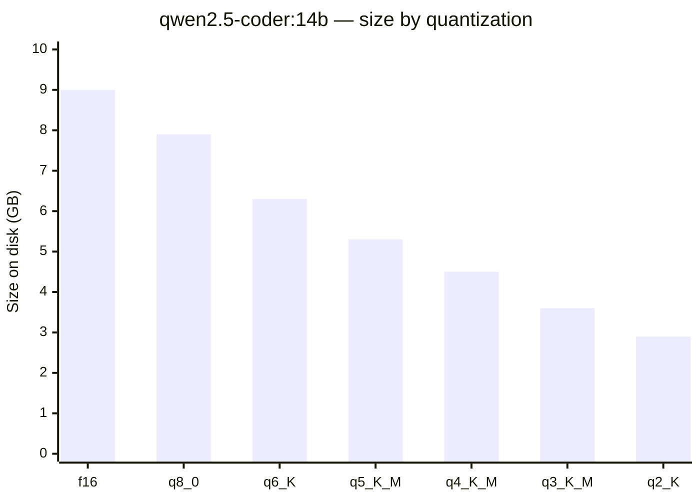

- **f16** = half-precision floating point. What the model was "born" in.
- **q8_0** = 8-bit. ~1% quality loss, 44% smaller. Almost always worth it.
- **q4_K_M** = 4-bit "K-quant medium" — the sweet spot most people use. ~3–5% quality loss, 50% smaller vs f16.
- **q2_K** = aggressive, noticeably degraded output. Useful only when you're trying to fit a giant model on small hardware.

**Rule:** on tight cards, prefer q4_K_M for the model and q8_0 for the KV cache. The weights tolerate quantization better than the KV cache does.

---

## Primer: What is "thinking mode"?

Some models (qwen3, DeepSeek-R1, OpenAI o-series-compatible models) generate **hidden reasoning tokens** before every user-visible response. These tokens let the model "think out loud" internally, improving quality on hard problems — at the cost of speed.

```mermaid
sequenceDiagram
    participant U as You
    participant M as Model

    Note over U,M: Without thinking mode (qwen2.5-coder)
    U->>M: "write a bash script"
    M-->>U: token 1
    M-->>U: token 2
    M-->>U: ... (immediate visible output)

    Note over U,M: With thinking mode (qwen3)
    U->>M: "write a bash script"
    M->>M: &lt;think&gt; step 1
    M->>M: &lt;think&gt; step 2
    M->>M: &lt;think&gt; ... hundreds of tokens hidden
    M->>M: &lt;/think&gt;
    M-->>U: token 1 (visible)
    M-->>U: token 2 (visible)
```

On artofwar:
- `qwen3:32b` with thinking: **~3 tok/s** (measured; the thinking tokens count against your wall-clock time).
- `qwen2.5-coder:32b` no thinking: **~15 tok/s**.

**5x speedup** by picking the non-thinking model. We use `qwen2.5-coder` for agent work and only reach for qwen3/R1 when a specific task benefits from the extra reasoning.

---

## Primer: Why tool-use support matters

An "agent" is an LLM + a harness that lets it call tools (read file, write file, run bash, search the web). Without tools, you have a chatbot. Tool use is implemented via a **specific JSON schema** the model must know how to emit.

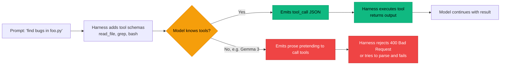

Ollama checks the model's declared capabilities (`completion`, `vision`, `tools`) at the API layer and **refuses to forward tool schemas** to models that don't declare `tools`. That's why Gemma 3 is fast chat but useless for agents, and why the `qwen2.5-coder` family is the safe default.

Check any model's capabilities with `ollama show <model> | grep -A 3 Capabilities`.

---

## Seven traps we've hit (and won't again)

1. **`WatchdogSec` on Ollama systemd** — kills Ollama every N seconds because Ollama doesn't send `sd_notify` heartbeats. Cost us 2 days of failed 17 GB model downloads before we caught it.
2. **Multi-GPU defaults on single-GPU PC** — `NUM_PARALLEL=4` + large model on an 8 GB display-GPU = instant black-screen. Fixed by Profile A with `OLLAMA_GPU_OVERHEAD`.
3. **Gemma 3 has no tool support in Ollama** — fast (~20 tok/s) but Ollama refuses to pass tool schemas. Chat only.
4. **qwen3 has thinking mode** — generates hidden reasoning tokens before each response, ~80% slower than non-thinking equivalents. The `qwen2.5-coder` family doesn't.
5. **`claw` refuses to run in `$HOME`** — considers it "too broad." The `ccode` wrapper `cd`s into `~/claw-test`.
6. **Ctrl+C doesn't kill a hung claw** — raw-mode TTY swallows SIGINT. From a second session: `pkill -INT claw` → `pkill -TERM claw` → `pkill -KILL claw`.
7. **Co-resident tools are mostly innocent** — Go/Python/Bash CLIs don't touch CUDA. Dangerous ones: `llama.cpp` / LM Studio / second `ollama run` / Stable Diffusion. Check with `nvidia-smi --query-compute-apps=pid,process_name,used_memory --format=csv`.

Full detail on every one: [`LOCAL-CLAUDE-SETUP.md`](LOCAL-CLAUDE-SETUP.md#gotchas-we-hit-so-you-dont-have-to).

---

## Pre-launch checklist (flowchart)

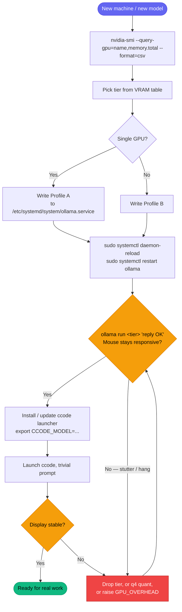

---

## Troubleshooting flowchart

Inference is slow, hung, or unstable. Walk this:

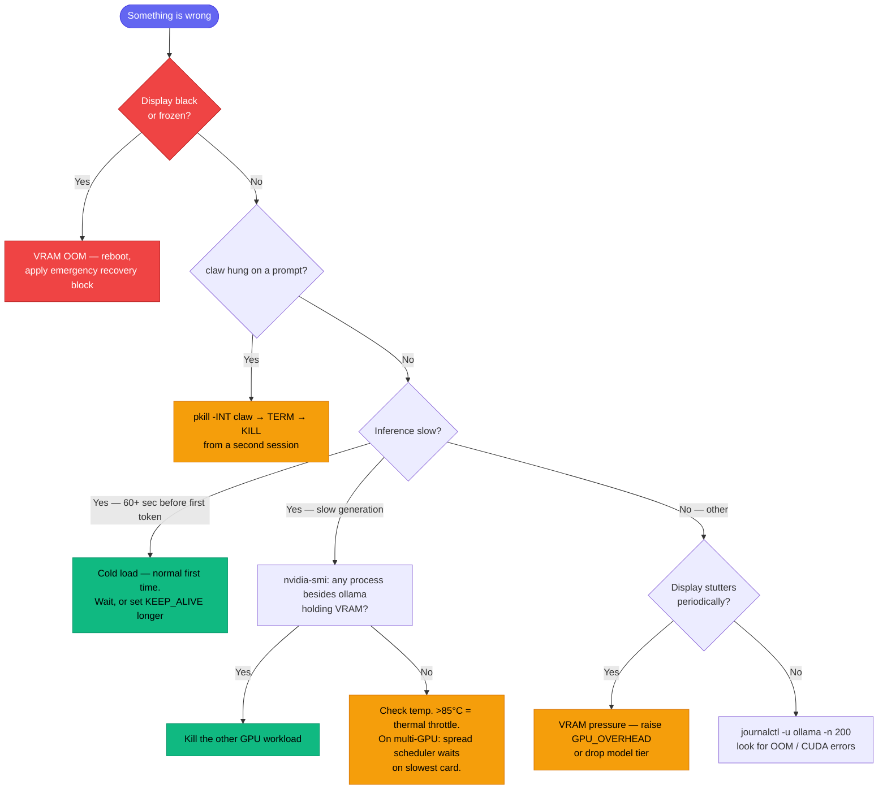

---

## Model lifecycle (state machine)

What happens to a model from the moment you `ollama pull` it to the moment it's evicted from VRAM:

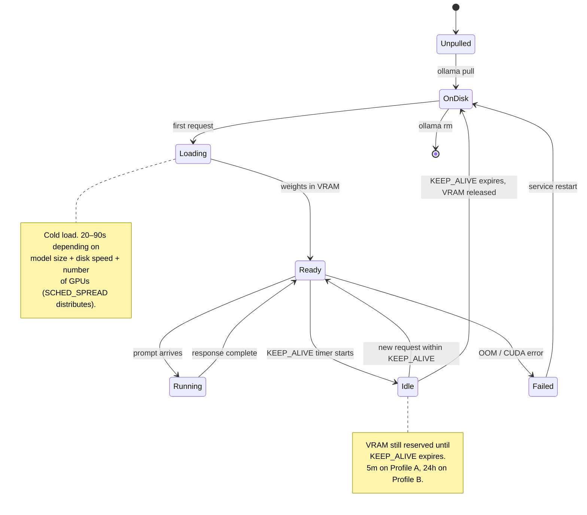

---

## Cost: local vs real Claude

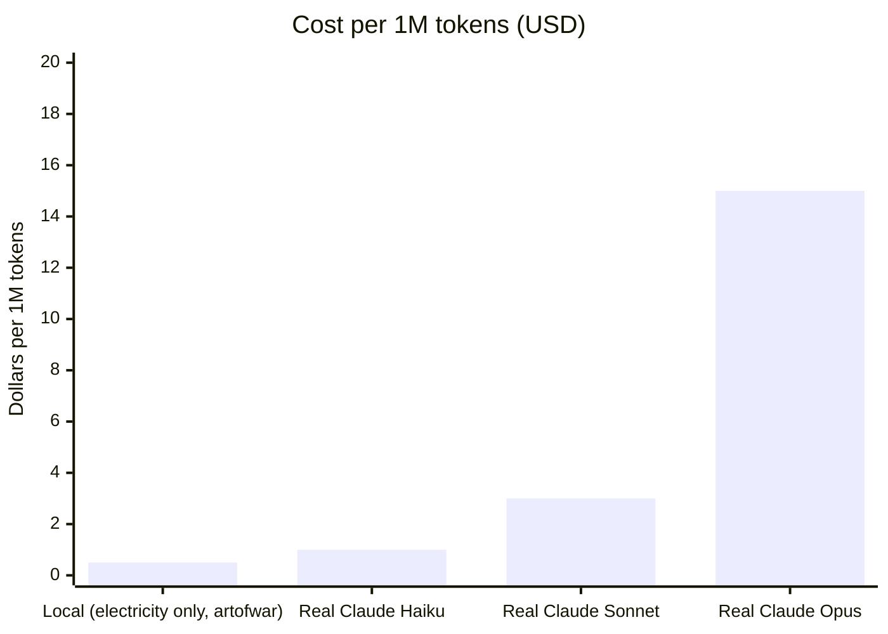

At ~$0.15/hr full GPU load on our rig, 1M tokens costs us roughly $0.50 in electricity. Real-Claude pricing is roughly:

| Tier | ~$ per 1M tokens |
|---|---:|
| Local (artofwar, electricity) | ~0.50 |
| Claude Haiku | ~1 |
| Claude Sonnet | ~3 |
| Claude Opus | ~15 |

**Smart play:** local for private, routine, and high-volume work; real Claude for heavy architectural reasoning and anything quality-critical. Same instinct as "home-cooked meals for weeknights, restaurant for date night."

---

## NotClaw mindmap — the whole space

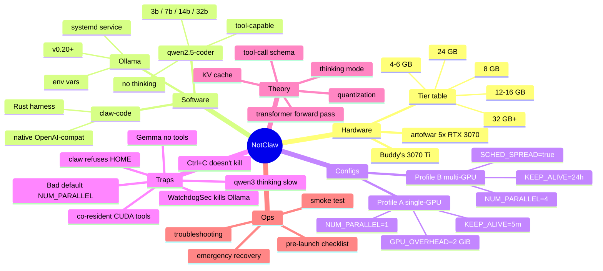

---

## Related — but separate

- **[`ultraworkers/claw-code`](https://github.com/ultraworkers/claw-code)** — the Rust harness we run. 185k stars, Linux-x64 + macOS-arm64 release binaries only, build from source recommended.
- **[`instructkr/claude-code`](https://github.com/instructkr/claude-code)** — Python sibling in the same fork network. Identical commit stream to claw-code.
- **[`Ringmast4r/gridbasedotnet-CLAUDE`](https://github.com/Ringmast4r/gridbasedotnet-CLAUDE)** — our fork of a LiteLLM-proxy approach to running the real Claude Code npm CLI against Ollama. **Separate concern**, lives at `Desktop/GITHUBS/gridbasedotnet-CLAUDE/`. Upstream `gridbasedotnet/CLAUDE` returns 404 as of 2026-04-17 — our fork is now the canonical git home for that path.
- **[Ollama](https://ollama.ai)** — the model server. On v0.21 on artofwar as of 2026-04-17.
- **[qwen2.5-coder model card](https://ollama.com/library/qwen2.5-coder)** — the model family we use.

---

## Workspace status

- **Repo:** [`Ringmast4r/NotClaw`](https://github.com/Ringmast4r/NotClaw) — private on GitHub.
- **Local path:** `C:\Users\Squir\Desktop\GITHUBS\NotClaw\`
- **NTFS permissions:** Inheritance broken 2026-04-17. Only `DESKTOP-QKOB615\Squir` + `NT AUTHORITY\SYSTEM` have access. `BUILTIN\Administrators` removed.
- **Git:** `main` branch, tracks `origin/main`. No CI, no branch protection.
- **Ollama minimum:** v0.20 for `OLLAMA_GPU_OVERHEAD`. Running v0.21 on artofwar as of 2026-04-17.
- **Latest incident folded in:** 2026-04-17 — single 3070 Ti black-screen case study.

---

## Glossary

| Term | Meaning |
|---|---|
| **Agent** | An LLM + a harness that lets it call tools (file I/O, shell, search). Without tools, you have a chatbot. |
| **Attention** | The core transformer operation: every token looks at every previous token to decide what to emit next. |
| **Context window** | The maximum number of tokens the model can "see" at once. qwen2.5-coder defaults to 32k; can be set higher. |
| **Forward pass** | One full sweep through all transformer layers to produce one next token. |
| **Harness** | The software layer that wraps the model and gives it tools (claw, aider, Cursor, Claude Code itself). |
| **KV cache** | Stored key/value vectors from previous tokens so attention doesn't recompute from scratch. Biggest VRAM surprise. |
| **Logits** | Raw scores for every token in the vocabulary at each step; sampling picks the next token from these. |
| **Prefill** | The first forward pass that processes your whole prompt before generation begins. |
| **Quantization** | Storing model weights at lower precision (4/8-bit) to shrink VRAM/disk footprint. |
| **Sampling** | How the model picks the next token from the logits. Temperature + top_p/top_k parameters control randomness. |
| **Spread scheduling** | Ollama spreading a large model across multiple GPUs via `OLLAMA_SCHED_SPREAD=true`. |
| **Thinking mode** | Hidden reasoning tokens the model emits before visible output (qwen3, R1). Slower but often smarter. |
| **Token** | The unit of input/output. Neither a word nor a character — learned during pretraining. ~4 chars on average in English. |
| **Tool use** | The model emitting structured JSON instead of prose, which the harness parses and executes. |

---

## FAQ

**Q: Does this work on Windows?**
A: The stack runs on Linux or WSL2. On native Windows, Ollama has a build but claw-code doesn't ship Windows binaries — you'd need to build from source. We run it on Linux (Kali/Ubuntu) via WSL2 or dedicated rigs.

**Q: Does it work on Mac (Apple Silicon)?**
A: Yes. Ollama has native Metal support, and claw-code ships a `claw-macos-arm64` release binary. Models load in unified memory — the VRAM-vs-RAM split doesn't apply. An M-series with 64 GB unified memory happily runs the 32b.

**Q: Can I use this with the real `claude` CLI instead of `claw`?**
A: Yes — that's what the sibling `gridbasedotnet-CLAUDE` repo does via a LiteLLM proxy that translates Anthropic API → Ollama. We prefer claw-code (fewer moving parts), but the proxy approach works.

**Q: Is the 32b actually as good as Claude Sonnet?**
A: No. It's closer to Haiku in reasoning quality. For routine code-reading, editing, grep, refactors, and shell loops — fine. For architectural reasoning across a large unfamiliar codebase — real Claude is still better. Use the right tool for the job.

**Q: Will this show up as "private" to GitHub employees / Anthropic?**
A: GitHub-private means not publicly searchable or cloneable. GitHub itself can technically access the repo storage (that's how any SaaS works). For zero-knowledge privacy, don't push to any remote — keep it local-only. Ours is on a private GitHub for backup/convenience; local files stay NTFS-locked regardless.

**Q: What happens if `ultraworkers/claw-code` goes the way of `gridbasedotnet/CLAUDE` and 404s?**
A: We already cloned it locally on artofwar. The binary is at `/usr/local/bin/claw`. If the upstream disappears, we still have the source + binary. Worth mirroring the repo to your own GitHub as a safety net.

**Q: Is `OLLAMA_GPU_OVERHEAD` really a big deal?**
A: Yes. It's the most important single-setting safety win for display-driving GPUs. Without it, Ollama will happily oversubscribe VRAM and the compositor dies. Set it to ~2 GiB on any GPU also driving a monitor.

**Q: Why not just use the `:q4_K_M` quantization of the 32b on a 12 GB card?**
A: q4 of 32b is ~11 GB just for weights. Add ~1–2 GB KV cache, ~1.5 GB framebuffer, and you're at ~14 GB on a 12 GB card. It *sometimes* loads but thrashes. The 14b-q4 fits comfortably instead. Don't force a size tier — pick the right one.

---

## Credits

*NotClaw — built and maintained by [@Ringmast4r](https://github.com/Ringmast4r). Private workspace. April 2026.*

<div align="center">


</div>
